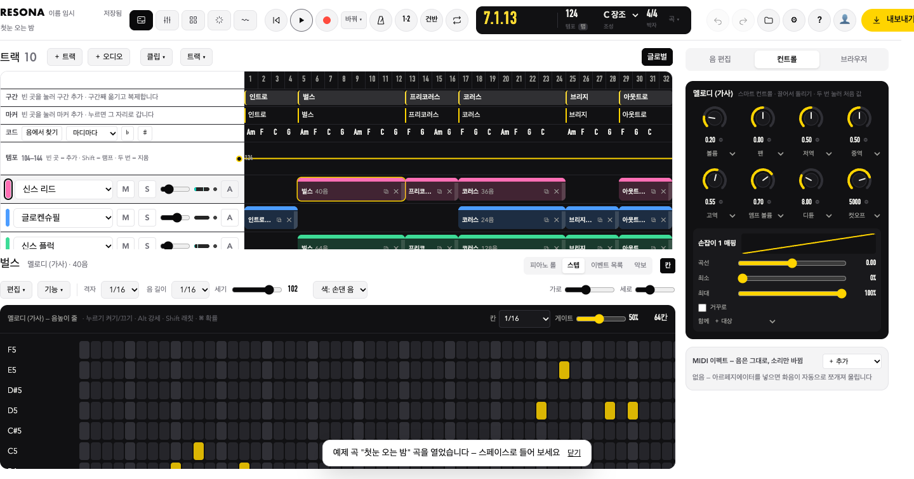
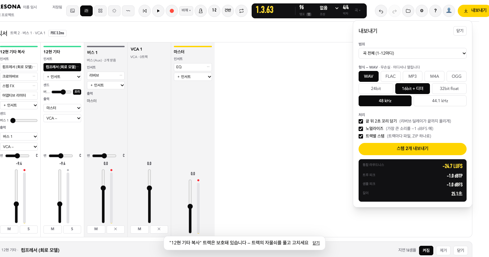

# RESONA

브라우저에서 도는 작곡 프로그램(DAW)입니다. 설치 없이 열어서 음을 찍고, 악기를 고르고, 믹스하고, 파일로 내보냅니다. 같은 화면을 데스크톱 앱(Electron)으로도 띄울 수 있습니다.

소리는 전부 내 컴퓨터에서 만들어집니다(Rust → WebAssembly). 서버는 로그인·저장·동기화만 맡고, 로그인하지 않아도 곡을 만들고 파일로 저장할 수 있습니다.



## 바로 써 보기

Node.js 20 이상이 필요합니다.

```bash
git clone git@github.com:namgh/play_music.git
cd play_music
npm install
npm run dev
```

브라우저에서 `http://127.0.0.1:5173` 을 엽니다(Chrome 권장). 처음이라면:

1. 오른쪽 위 **폴더 단추 → 새 곡 · 최근 곡 · 버전 → 예제 곡**에서 "첫눈 오는 밤"을 엽니다.
2. **스페이스**를 눌러 듣습니다.
3. 아래 편집기에서 음을 눌러 옮기거나 지워 봅니다.
4. 오른쪽 위 **내보내기**로 MP3나 WAV를 받습니다.

자세한 사용법은 **[사용 가이드](docs/GUIDE.md)** 에 있습니다.

## 할 수 있는 것

| | |
|---|---|
| **작곡** | 피아노 롤, 스텝 시퀀서, 이벤트 목록, 악보(가사 포함) — 네 가지 보기로 같은 음을 고칩니다 |
| **악기** | 55종(피아노·기타·현·신스·드럼…), 음마다 센트 단위 음정 |
| **편곡** | 구간(벌스·코러스), 마커, 코드 줄, 템포·박자 변화, 클립 나누기·합치기·반복 |
| **녹음** | 마이크 녹음, 오디오 파일 가져오기(WAV·MP3·AAC·FLAC·OGG), MIDI 건반 입력 |
| **믹스** | 트랙별 이펙트, 버스·센드, VCA, 오토메이션, 3D 패너, 마스터링 도우미 |
| **영상** | 영상을 불러와 장면에 음악 맞추기, 타임코드, 영상과 함께 내보내기 |
| **내보내기** | WAV · FLAC · MP3 · M4A · OGG, 트랙별 스템, MIDI, MusicXML, MP4 · WebM |



## 문서

| 문서 | 내용 |
|---|---|
| [docs/GUIDE.md](docs/GUIDE.md) | 사용 가이드 — 화면 구성, 곡 만드는 순서, 내보내기, 단축키 |
| [docs/AUTH.md](docs/AUTH.md) | 로그인 설계 — 이메일 가입과 구글 로그인을 한 계정으로 |
| [server/README.md](server/README.md) | 서버(FastAPI) 실행과 구조 |
| [LOGIC_PARITY.md](LOGIC_PARITY.md) | Logic Pro 대비 기능 표 — 무엇이 되고 무엇이 아직인지 |
| [CLAUDE.md](CLAUDE.md) | 개발 규칙과 작업 기록 |

## 데스크톱 앱

```bash
npm run dev            # 한쪽 터미널
npm run desktop:dev    # 다른 터미널 — 개발 서버를 데스크톱 창으로
npm run desktop        # 빌드한 화면을 데스크톱 창으로
```

아직 설치 파일(dmg·exe)과 자동 업데이트는 없습니다. 소스에서 실행하는 단계입니다.

## 서버 (로그인·클라우드 저장을 쓸 때만)

곡 만들기·파일 저장·내보내기는 서버 없이 됩니다. 로그인과 클라우드 저장을 쓰려면 Docker로 서버를 띄웁니다.

```bash
cd server
cp .env.example .env                 # 값 채우기 (아래)
docker compose --profile app up -d   # postgres · redis · api(8000) · worker · scheduler
```

개발 서버(5173)는 `/v1` 요청을 `localhost:8000` 으로 넘깁니다.

- **구글 로그인**: Google Cloud Console에서 OAuth 클라이언트를 만들고 `.env` 의 `GOOGLE_CLIENT_ID`, `GOOGLE_CLIENT_SECRET`, `GOOGLE_REDIRECT_URI` 를 채웁니다. 승인된 리디렉션 URI에 `http://localhost:8000/v1/auth/google/callback` 을 넣습니다.
- **확인 메일**: Gmail SMTP를 쓰려면 `SMTP_USER`, `SMTP_PASSWORD`(앱 비밀번호)를 채웁니다.

## 개발

```bash
npm run typecheck        # 타입 검사
npm run test:model       # 단위 시험 (Node, 브라우저 없이)
npm run check:browser    # 실제 Chrome 으로 화면 109항목 (개발 서버 필요, 10분쯤)
npm run check:scenarios  # 곡을 만들어 넣고 내보낸 파일을 다시 풀어 재는 시나리오 (20분쯤)
npm run build            # Rust(wasm) + 화면 빌드 — Rust 와 wasm32 타깃 필요
```

DSP(`dsp/`, `fx/`)를 고치지 않는다면 Rust는 필요 없습니다. 빌드된 wasm이 `src/generated/` 에 들어 있습니다.

```
src/model/      곡 데이터 (음·클립·트랙·템포), MIDI·악보 변환
src/editor/     편집 동작 (되돌리기, 클립·트랙 조작, 저장)
src/audio/      재생 엔진, 이펙트, 내보내기·인코딩
src/ui/         화면 (React)
dsp/  fx/       악기·이펙트 DSP (Rust → wasm)
desktop/        Electron 껍데기
server/         FastAPI 서버 (계정·저장·과금)
tools/          점검 스크립트
```

## 아직 안 되는 것

- 사람 목소리 합성 — 가사는 음에 붙는 글자이고, 보컬은 오디오 트랙에 직접 녹음합니다.
- 5.1·Atmos 스피커 출력, 설치 파일·자동 업데이트.
- 오디오 늘이기(Flex Time/Pitch), 오케스트라 샘플 악기.
- 구글 로그인은 서버 시험으로만 확인했고 실제 구글 계정으로는 아직 돌려 보지 않았습니다.

## 라이선스 고지

내보내기 인코딩에 [mediabunny](https://mediabunny.dev)(MPL-2.0)와 LAME(MP3, LGPL), FFmpeg AAC 인코더(LGPL), libFLAC(BSD)의 WebAssembly 빌드를 씁니다. 각 라이선스 전문은 `node_modules/@mediabunny/*/licenses` 에 있습니다. MP3 인코딩은 [LAME](https://lame.sourceforge.io) 덕분입니다.
