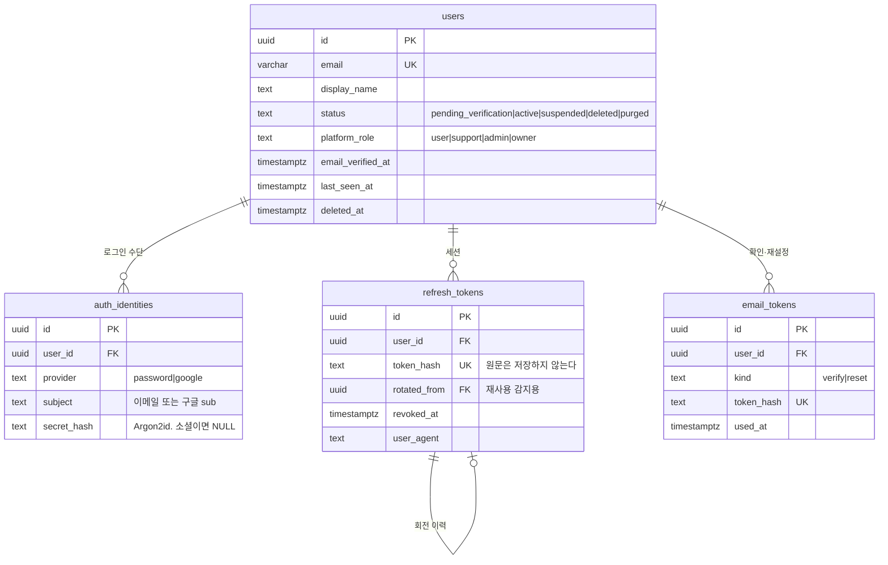
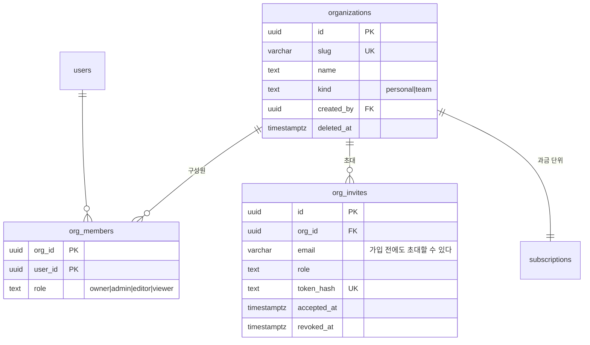
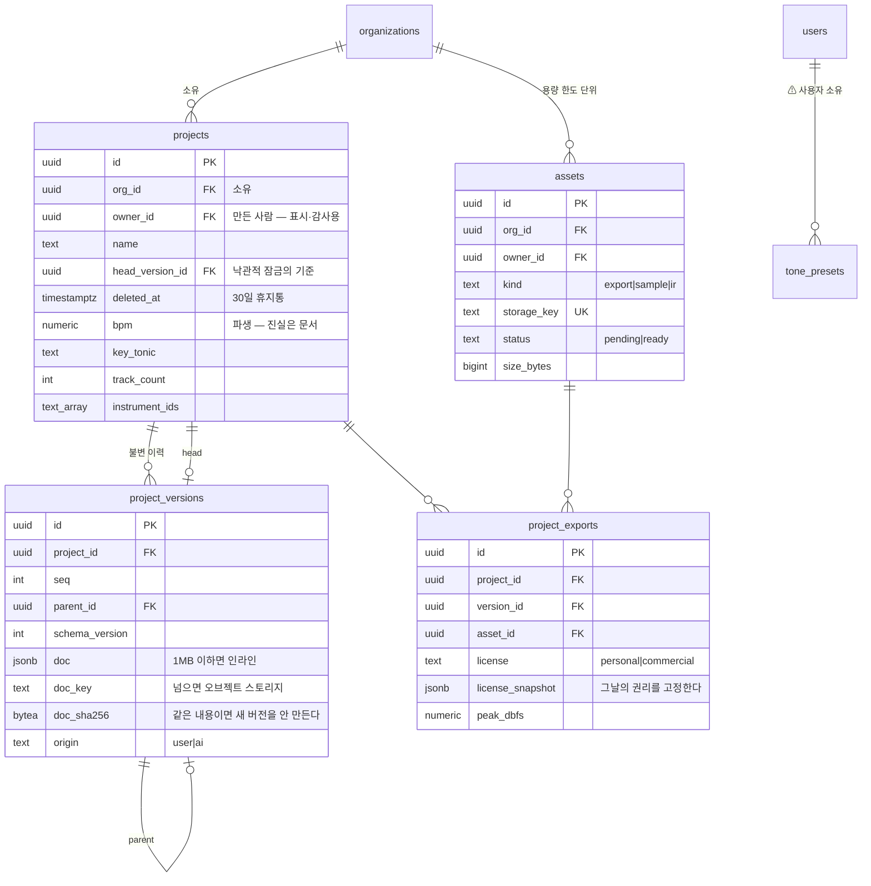
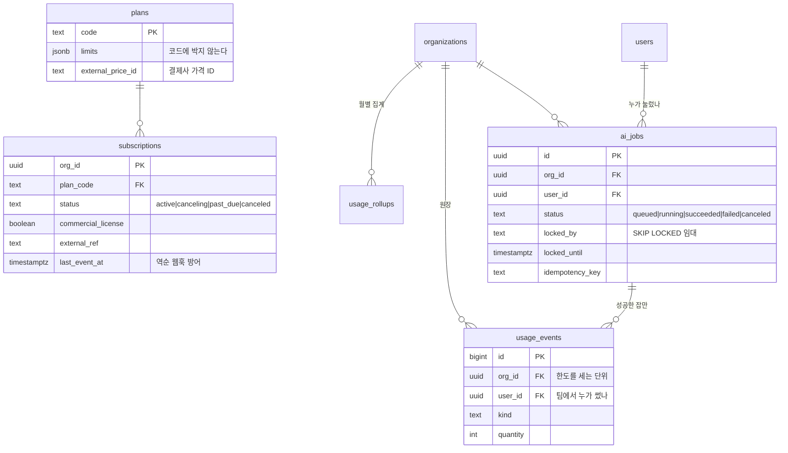

# 데이터 모델 (ERD) — 현재 상태와 앞으로 설계할 것

> 2026-08-17. 실제 DB(`server/app/db/models.py`, 마이그레이션 4개 적용본)를 읽고
> 그린 것이다. **문서가 아니라 스키마가 원본이다** — 둘이 어긋난 곳은 아래
> "문서가 약속했는데 없는 것"에 따로 적었다.
>
> 테이블 24개 · 외래키 41개 · 인덱스 52개.

## 0. 이 문서를 먼저 읽어야 하는 이유

데이터 모델에서 **비싼 실수는 딱 하나**다 — *무엇이 무엇을 소유하는가*를 틀리는 것.
그건 나중에 고치면 전면 마이그레이션이 된다. 실제로 한 번 겪었다: 프로젝트·구독·
사용량을 사용자 소유로 만들었다가 팀 기능을 넣으며 전부 조직 소유로 옮겼다
(`20260811_2158_org_workspaces_and_mail_outbox.py` — 백필과 기본키 교체까지 필요했다).

그래서 새 테이블을 만들 때 **가장 먼저 답해야 하는 질문**은 이것이다:

> 이건 **일감**인가, **사람**인가?

| | 소유자 | 예 | 판정 근거 |
|---|---|---|---|
| **일감·자산·청구 대상** | `organizations` | 프로젝트, 에셋, 내보내기, 잡, 사용량, 구독 | 사람이 팀을 떠나도 **남아야** 한다 |
| **정체성·취향·동의** | `users` | 프로필, 알림 설정, MFA, 약관 동의, 즐겨찾기 | 사람을 따라 **움직여야** 한다 |

애매하면 "이 사람이 팀을 나가면 이것도 같이 나가야 하나?"를 물으면 갈린다.

---

## 1. 지금 있는 것

### 1-1. 계정·인증



**설계 판단이 들어간 곳**
- `auth_identities(provider, subject)` 유니크 — 구글·비밀번호·나중의 애플까지 스키마
  변경 없이 붙는다. 구글 로그인을 추가할 때 실제로 마이그레이션이 필요 없었다
- `refresh_tokens.rotated_from` — 재사용 감지의 근거. 이미 회전된 토큰이 다시 오면
  그 계정의 전 세션을 끊는다
- 토큰은 **해시만** 저장한다. DB 가 유출돼도 세션이 털리지 않는다

### 1-2. 워크스페이스·권한



**핵심**: 개인 계정도 `kind='personal'` 인 1인 조직이다. 개인 경로와 팀 경로를
따로 두면 목록·권한·과금·삭제가 두 벌이 되고 한쪽에만 있는 버그가 반드시 생긴다.

권한은 **2축**이다 — `users.platform_role`(운영자)은 리소스 접근을 주지 않는다.
플랫폼 admin 이라도 남의 워크스페이스에는 못 들어간다.

### 1-3. 콘텐츠



**설계 판단**
- **버전은 절대 UPDATE 하지 않는다.** `head_version_id` 만 움직인다. 저장은
  `If-Match` 낙관적 잠금이고, 충돌하면 409 에 **현재 문서를 실어** 보낸다
- `doc_sha256` 이 같으면 새 버전을 안 만든다 — 자동 저장이 이력을 더럽히지 않게
- `license_snapshot` 은 **내보낸 시점의 권리를 통째로 박제**한다. 구독을 해지해도
  이미 내보낸 곡의 상업 이용권은 살아 있다

### 1-4. 과금·운영



그 밖의 운영 테이블: `audit_log`, `impersonation_sessions`, `idempotency_keys`,
`billing_events`(웹훅 중복·역순 방어), `email_outbox`(트랜잭션과 함께 커밋되는 메일 큐).

---

## 2. 확인된 문제 — 고쳐야 할 것

### 2-1. ~~⚠ 탈퇴 파기가 **돈의 근거를 지운다**~~ → **고쳤다 (2026-08-18)**

설계 의도는 "개인정보는 지우고, 돈과 감사의 근거는 남긴다"인데 **반대로 동작한다.**

파기 절차가 개인 워크스페이스를 `DELETE` 하고, 거기서 CASCADE 가 퍼진다:

```
DELETE organizations(personal)
   └─CASCADE→ usage_events      (사용량 원장)
   └─CASCADE→ usage_rollups
   └─CASCADE→ subscriptions     (구독 이력)
   └─CASCADE→ projects → project_versions, project_exports
   └─CASCADE→ assets
```

실측: 파기 후 `usage_events` 0행, `subscriptions` 0행.

**결제 분쟁이 나면 우리도 사용자도 아무것도 증명할 수 없다.** 그리고 그 뒤에 있는
`UPDATE usage_events SET user_id = NULL` 은 이미 사라진 행을 손대므로 아무 일도 안 한다.

> **테스트가 이름과 반대되는 것을 검증하고 있었다.**
> `test_purge_removes_personal_data_but_keeps_the_ledger` 가
> `count(*) WHERE user_id = :u == 0` 을 단언하는데, 행이 **삭제되면** 그것도 0 이다.
> 지워졌는지 남았는지를 구분하지 못하는 단언이었다.

**고친 방향**: 사람에게 한 것과 같게 했다 — **조직도 지우지 않고 익명화한다.**
콘텐츠(프로젝트·버전·에셋)만 지우고 조직 행·구독·원장은 남긴다.

같은 각본을 다시 돌린 결과:

```
파기 전 — 원장 1행(연결 1) · 구독 1행 · 곡 1개 · 조직 active
파기 후 — 원장 1행(연결 0) · 구독 1행 · 곡 0개 · 조직 purged, 이름·슬러그 익명화
```

거짓말하던 테스트도 바꿨다. `count(*) WHERE user_id = :u == 0` 대신 **조직 기준으로
몇 행이 남았는지**를 세므로, 이제 지워지면 빨간불이 켜진다.

```
organizations.status  active | deleted | purged     ← 추가
organizations.name/slug 를 익명 값으로 덮는다
```

### 2-2. ⚠ `project_members` 는 **아무도 안 쓰는 죽은 테이블**

"협업은 MVP 밖이지만 나중에 넣으면 전체 마이그레이션이라 먼저 둔다"는 주석과 함께
만들어졌는데, 그 뒤 **조직 단위 권한(`org_members`)이 그 역할을 대신**했다.
지금 `app/` 어디에서도 참조하지 않는다.

**권한 테이블이 둘이면 언젠가 둘 다 보는 코드가 생기고, 그때 한쪽만 검사하는 버그가
난다.** 지금 결정해야 한다:
- (A) 삭제 — 프로젝트 단위 공유는 "공유 링크"로 대신한다 (아래 3-2)
- (B) 살림 — 조직 안에서 특정 프로젝트만 열어 주는 용도로 명시하고 권한 검사에 편입

권장은 **(A)**. 조직이 이미 협업 경계이고, 그 안에서 더 잘게 나누는 요구는 아직 없다.

### 2-3. ⚠ 사람을 지우면 **팀의 곡이 사라지는** 지뢰

`projects.owner_id → users ON DELETE CASCADE`.

지금은 안 터진다 — 파기가 `users` 행을 지우지 않고 익명화하기 때문이다. 하지만
누군가 하드 삭제를 한 줄 넣는 순간, **그 사람이 만든 팀 프로젝트가 통째로 사라진다.**
`owner_id` 는 표시·감사용이지 소유가 아니므로 `SET NULL` 이 맞다.
같은 문제: `assets.owner_id`, `tone_presets.owner_id`.

### 2-4. `tone_presets` 만 사용자 소유다

다른 일감은 전부 조직 소유인데 프리셋만 `owner_id → users` 다. 팀에서 만든 음색을
팀이 못 쓴다. 0-절의 판정 기준("팀을 나가면 같이 나가야 하나?")으로는 **조직 소유**가
맞다. 지금 옮기는 것이 나중보다 싸다 — 아직 데이터가 없다.

### 2-5. 문서가 약속했는데 스키마에 없는 것

| 문서 | 약속 | 현재 |
|---|---|---|
| `SERVER_ACCOUNTS.md` 4절 | `support_consents` + `impersonation_sessions.consent_id` | **없음.** "사용자 동의가 선행한다"가 스키마로 강제되지 않는다 |
| `SERVER_ACCOUNTS.md` 2-3 | `user_mfa` (자리만) | 없음 |
| `SERVER_ACCOUNTS.md` 8절 | 데이터 반출(export) | API 없음 |
| `SERVER_READINESS.md` 19 | 약관·개인정보 동의 기록 | **없음** |

---

## 3. 앞으로 설계할 것

우선순위는 **"없으면 무슨 일이 나는가"**로 정했다. 각 항목에 그 답을 적었다.

### 3-1. P0 — 서비스를 열기 전에 (법·신뢰)

| 테이블 | 없으면 |
|---|---|
| `user_consents(user_id, kind, version, granted_at, ip, user_agent)` | 개인정보 수집·이용 동의를 **증명할 수 없다.** 나중에 붙이면 기존 사용자 전원에게 재동의를 받아야 한다 |
| `support_consents(user_id, granted_at, expires_at, revoked_at)` | 고객지원이 **동의 없이** 계정을 열 수 있다. 문서가 금지한 상태 |
| `organizations.status` + 파기 절차 수정 | 2-1 — 돈의 근거가 사라진다 |
| `legal_documents(kind, version, effective_at, url)` | "어느 버전에 동의했는지"를 못 가리킨다. 약관이 바뀌면 재동의 대상을 특정할 수 없다 |

동의는 **버전을 함께 남긴다.** `kind`(tos/privacy/marketing) × `version` 이 있어야
약관 개정 시 누구에게 재동의를 받을지 SQL 한 줄로 나온다.

### 3-2. P1 — 제품이 성립하려면

| 테이블 | 없으면 |
|---|---|
| `users` 프로필 확장: `locale`, `timezone`, `avatar_asset_id` | 메일이 새벽에 가고, 화면을 번역할 수 없다 |
| `notification_prefs(user_id, kind, channel, enabled)` | 전부 보내거나 전부 안 보내거나 둘 중 하나. 수신 거부를 못 받으면 발신 도메인 평판이 깎인다 |
| `project_shares(project_id, token_hash, scope, expires_at, revoked_at)` | **"내 곡 들어봐"가 안 된다.** 음악 서비스의 확산 경로가 통째로 없다 |
| `project_folders` 또는 `project_tags` | 곡이 50개 넘으면 목록이 못 쓰게 된다 |
| `billing_invoices(org_id, external_id, amount, currency, issued_at, snapshot)` | 사용자가 **자기가 낸 돈을 확인할 수 없다.** 스냅샷을 함께 저장해 조직이 익명화돼도 홀로 선다 |
| `refresh_tokens`에 `last_used_at`, `ip` | "내 로그인 기기" 화면과 원격 로그아웃을 못 만든다 |

`project_shares` 설계 메모: 토큰은 **해시만** 저장하고(초대·재설정과 같은 규칙),
`scope` 로 듣기 전용 / 사본 만들기 허용을 나눈다. 만료와 폐기를 반드시 둔다 —
한 번 나간 링크를 못 거두면 그게 곧 유출이다.

### 3-3. P2 — 열고 나서 곧 필요한 것

| 테이블 | 왜 |
|---|---|
| `user_mfa(user_id, kind, secret_enc, confirmed_at, backup_codes)` | 유료 사용자가 요구한다. 자리는 문서가 이미 잡아 뒀다 |
| `share_comments(share_id, author_name, body, at_tick)` | 피드백이 곡의 **특정 지점**에 붙어야 쓸모가 있다 |
| `support_tickets(user_id, subject, status)` | 오류 화면에 `request_id` 를 실어 주면서 정작 **받을 창구가 없다** |
| `feature_flags(key, rule)` | 위험한 기능을 일부에게만 열 수 없다 |
| `project_templates` | 빈 화면에서 시작하는 사람은 대부분 떠난다 |
| `user_memory` (이미 있음, 미사용) | AI Phase 3 에서 쓴다 — 지금은 건드리지 않는다 |

### 3-4. 설계할 때 지킬 규칙

1. **일감은 조직, 사람은 사용자.** 새 테이블마다 0-절의 질문에 먼저 답한다
2. **돈과 감사의 근거는 CASCADE 경로에 두지 않는다.** 지우는 대신 익명화한다
3. **토큰은 해시만.** 초대·재설정·공유 링크 전부 같은 규칙
4. **비밀은 컬럼이 아니라 스냅샷으로 굳힌다** — 라이선스·인보이스처럼 나중에
   원본이 바뀌어도 그날의 근거가 남아야 하는 것
5. 새 테이블은 **먼저 이 문서에 그리고** 마이그레이션을 만든다. 순서를 바꾸면
   문서가 코드를 못 따라간다

---

## 4. 지금 상태 한 줄

**계정·워크스페이스·콘텐츠·과금의 뼈대는 서 있다.** 빠진 것은 두 종류다 —
**법적으로 필요한 동의 기록**과, **음악 서비스가 음악 서비스이게 하는 공유·정리
기능**. 그리고 파기가 돈의 근거를 지우는 문제는 지금 고쳐야 한다(데이터가 쌓인
뒤에는 되돌릴 수 없다).
