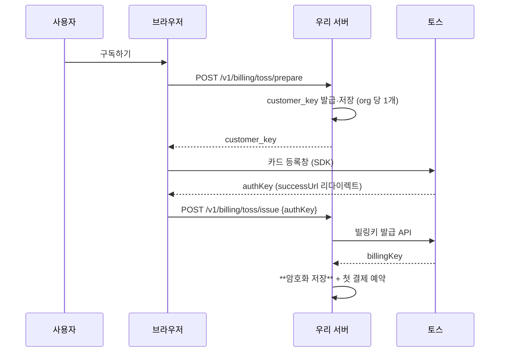
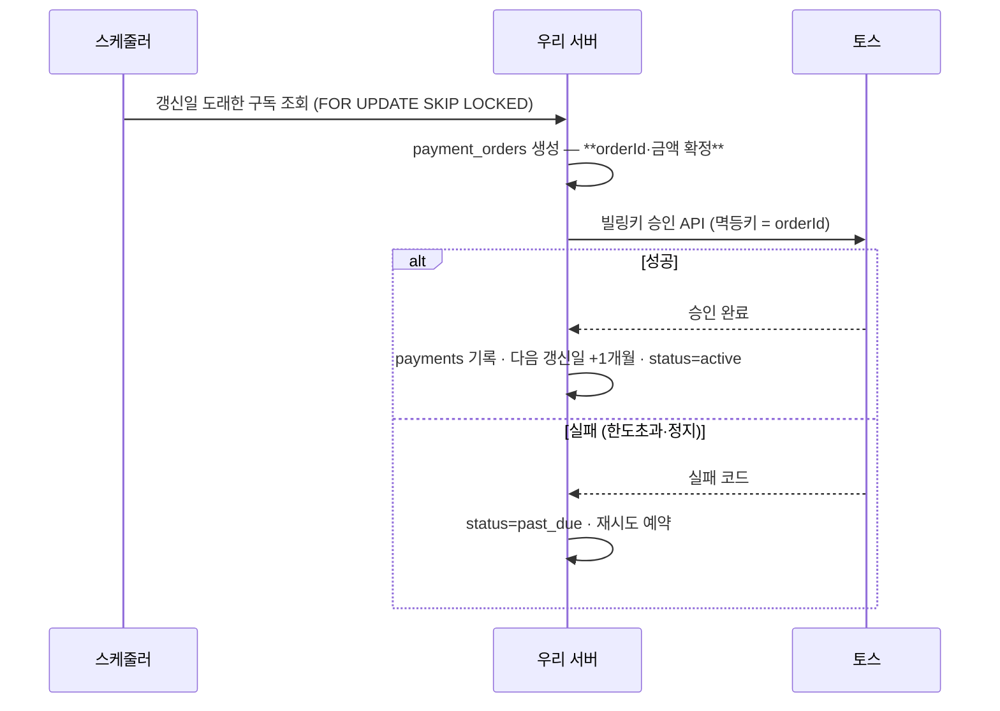
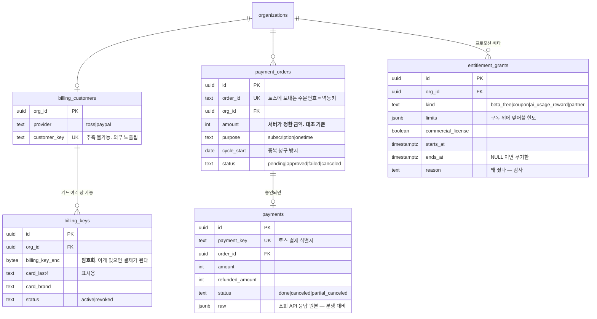

# 결제 연동 — 토스페이먼츠 설계와 작업 분할

> 2026-08-17. **이 문서는 "결제사와 어떻게 주고받는가"를 다룬다.**
> "누가 무엇을 할 수 있는가"(구독 상태기계·한도·상업 이용권)는 `SERVER_BILLING.md` 다.
> 둘을 섞지 말 것 — 결제사는 언젠가 바뀌지만 구독 도메인은 그대로 남아야 한다.

## 0. 확정된 전제

| | |
|---|---|
| 상품 | 음악 제작(DAW) **월 ₩4,400 무제한** (VAT 포함 표시) |
| 무료 | **누적 5곡**까지. 다 쓰면 새 곡만 막히고 기존 곡은 계속 쓴다 |
| 베타 | **초반 3개월 무료** — 카드 없이 |
| 결제 | **국내 = 토스페이먼츠**, 해외 = PayPal (뒤에) |
| 주기 | **월별만.** 연 결제는 베타에서 안 받는다 (제품이 바뀌면 환불 부채가 된다) |
| AI | Phase 3. 그때 별도 과금 + "AI 많이 쓰면 DAW 면제" 프로모션 |

---

## 1. 토스는 Stripe와 다르다 — 설계가 바뀌는 세 가지

지금 `app/api/v1/billing.py` 는 **Stripe 전제**로 쓰여 있다(checkout session, customer portal).
그대로 못 쓴다. 다른 점이 셋인데, 셋 다 작은 차이가 아니다.

### 1-1. ⚠ 토스는 구독을 대신 굴려주지 않는다

Stripe 는 구독 객체를 만들면 **자기가 매달 청구한다.** 토스는 아니다.
토스가 주는 건 **빌링키**뿐이고, **매달 긁는 건 우리 일이다.**

```
Stripe   구독 생성 → (Stripe 가 매달 청구) → 웹훅으로 결과 통보
토스     빌링키 발급 → **우리 스케줄러가 매달 승인 API 호출** → 응답이 곧 결과
```

그래서 필요한 것: 다음 결제일 관리, 결제 실행 잡, 실패 재시도, 중복 청구 방지.
**"결제사가 알아서 해주겠지"가 성립하지 않는다.** 이미 `app/scheduler/` 가 있으니 거기 붙는다.

### 1-2. 결제창이 아니라 **승인 API**가 결제를 확정한다

사용자가 결제창에서 카드 인증을 끝내도 **아직 결제가 안 된 것이다.**
서버가 승인(confirm) API 를 호출해야 돈이 움직인다.

이게 좋은 점이 하나 있다 — **승인 직전에 우리가 개입할 수 있다.** 금액이 맞는지,
이미 처리한 주문인지, 그 조직이 결제할 자격이 있는지를 돈이 움직이기 전에 본다.

### 1-3. 웹훅 검증 방식이 다르다

Stripe 는 로컬 HMAC 검증이라 외부 호출 없이 위조를 걸러낸다. 토스는 방식이 다르다
(서명·IP 허용목록 — **연동 전 공식 문서로 확인할 것**). 검증이 약한 쪽이면
위조 웹훅 하나로 유료 전환이 되는 구멍이 생긴다.

→ 그래서 아래 2절의 원칙을 둔다.

---

## 2. 신뢰 경계 — 무엇을 믿고 무엇을 안 믿나

`SERVER_BILLING.md` 5절이 "웹훅의 **순서**를 믿지 않는다"고 했다.
토스에서는 한 단계 더 간다 — **웹훅의 내용도 믿지 않는다.**

| 출처 | 믿나 | 이유 |
|---|---|---|
| 클라이언트가 보낸 **금액** | **아니오** | 조작된다. 서버가 저장해 둔 값과 대조한다 |
| 클라이언트가 보낸 orderId | 조회 키로만 | 남의 주문을 가리킬 수 있다 — 소유자를 확인한다 |
| **웹훅 본문** | **아니오** | "뭔가 바뀌었다"는 **신호로만** 쓴다 |
| **조회 API 응답** | **예** | 우리 시크릿 키로 토스에 직접 물은 것. 유일한 진실 |

### 이렇게 하면 위조 웹훅이 무해해진다

```
공격자: POST /billing/webhook  {"결제 성공했음", "orderId": "남의것"}
우리:   ① 통째로 billing_events 에 적는다 (판단하지 않는다)
        ② paymentKey 로 **토스에 조회한다**
        ③ 토스: "그런 결제 없음" → 아무 일도 안 일어남 + 감사 기록
```

서명 검증이 뚫려도 **돈이나 권한이 안 움직인다.** 서명 검증은 그대로 하되,
그것 **하나에 기대지 않는** 구조다.

### ⚠ 금액 위변조 — 가장 흔한 실수

```
승인 요청이 이렇게 오면:  ?paymentKey=xxx&orderId=yyy&amount=100
그대로 confirm 하면:      ₩4,400 짜리를 ₩100 에 판다
```

**방어**: 결제를 시작할 때 서버가 `orderId` 와 **금액을 먼저 저장**한다.
승인 시 그 저장값으로만 confirm 한다 — 클라이언트가 준 금액은 **대조용으로만** 쓰고,
다르면 거절하고 감사에 남긴다. (토스 문서도 필수 검증으로 명시한다)

---

## 3. 결제 흐름

### 3-1. 빌링키 발급 (최초 1회)



**`customer_key` 는 추측 불가능한 값**이어야 한다. 조직 UUID 를 그대로 쓰지 않는다 —
외부에 노출되는 값이라, 내부 식별자를 그대로 내보내면 조직 존재 여부가 새어 나간다.

### 3-2. 정기 결제 (매달, 우리가 실행)



**`orderId` 를 멱등키로 쓴다.** 스케줄러가 두 번 돌거나 프로세스가 죽었다 살아나도
같은 주기에 두 번 청구되지 않는다. **이건 돈이라 실수가 용납되지 않는 지점이다.**

### 3-3. 결제 실패 상태기계

```
active ──결제 실패──▶ past_due ──(+1일)──▶ 재시도 1
                        │                      │
                        │◀─────────성공────────┘
                        │
                     (+3일) 재시도 2 ─┐
                        │             │
                     (+7일) 재시도 3 ─┤ 전부 실패
                        │             ▼
                        └────────▶ canceled (읽기 전용 전환)
```

`past_due` 에서 **즉시 막지 않는다** — 카드 만료로 작업이 잠기는 경험이 해지보다 나쁘다
(`SERVER_BILLING.md` 2절). 다만 **해지되어도 만든 곡은 안 지운다.** 새 곡만 막힌다.

---

## 4. 스키마

기존 `subscriptions` 는 그대로 두고(도메인), 결제사 접점만 새로 만든다.



**`payment_orders.cycle_start`** 에 `(org_id, cycle_start)` 유니크를 건다 —
**같은 달에 두 번 청구하는 사고를 DB 가 막는다.** 코드로만 막으면 프로세스 둘이 통과한다.

**`payments.raw`** 는 조회 API 응답을 통째로 넣는다. 분쟁이 나면 "그때 토스가 뭐라고
했는지"가 유일한 증거다. 파싱한 컬럼만 남기면 나중에 필요한 필드가 없다.

### `entitlement_grants` — 지금 만들어야 하는 이유

지금 `entitlements.resolve()` 는 **`subscriptions` 한 행으로만** 판정한다.
그런데 앞으로 들어올 것들이 전부 구독이 아니다:

| | |
|---|---|
| 베타 3개월 무료 | 구독이 아니다. 기간 한정 **부여**다 |
| "AI 많이 쓰면 DAW 면제" | 조건 충족 시 **부여** |
| 쿠폰·파트너·내부 계정 | 전부 **부여** |

판정을 **`구독 + 유효한 부여들`의 합성**으로 지금 열어두면 넷이 같은 자리에 들어온다.
결제가 굴러간 뒤에 바꾸면 판정 로직 전체를 건드리게 된다. **지금이 제일 싸다.**

---

## 5. 베타 3개월 무료 — 카드 없이

두 가지 방식이 있는데 **카드 없이**로 간다.

| | 카드 받고 3개월 후 자동과금 | **카드 없이 3개월** |
|---|---|---|
| 테스터 수 | 적다 (결제 벽) | 많다 |
| 전환율 | 높다 | 낮다 |
| 한국 규제 | **자동결제 사전고지 대상** | 해당 없음 |
| 분쟁 | "몰랐다" 환불 요구 | 없다 |

**베타의 목적은 매출이 아니라 학습이다.** 지금 미해결 위험이 전부 사람이 써봐야 풀리는
것들이다 — 브라우저 실행 검증, 블라인드 A/B 청취(`CLAUDE.md` 다음 할 일). 카드 벽은
테스터 필터다.

구현은 가입 시 `entitlement_grants(kind='beta_free', ends_at=+3개월)` 한 줄이다.
만료되면 자동으로 무료 티어로 내려오고, **곡은 안 지운다. 새 곡만 막힌다.**

---

## 6. 보안 체크리스트 — 연동 전 전부 통과해야 한다

- [ ] **카드번호를 우리 서버가 절대 안 받는다** (PCI 범위 밖 유지) — 토스 SDK 가 직접 받는다
- [ ] 승인 금액은 **서버 저장값**으로만. 클라이언트 값은 대조용
- [ ] `orderId` 소유자 확인 — 남의 주문을 승인시킬 수 없다
- [ ] **빌링키 암호화 저장.** 카드번호는 아니지만 **결제를 일으킬 수 있는 자격증명**이다
- [ ] 빌링키 조회·사용을 감사에 남긴다
- [ ] 시크릿 키는 `Settings` 로만. `.env.example` 에는 빈 값
- [ ] 웹훅: 서명 검증 **하고**, 그와 별개로 조회 API 로 재확인
- [ ] 결제 관련 로그에 카드·빌링키·이메일이 안 찍힌다 (`PiiFilter`)
- [ ] 승인 API 타임아웃 시 **재시도하지 않는다** — 조회로 결과를 확인한다 (이중 청구 방지)
- [ ] 테스트는 토스 **테스트 키**로만. 운영 키가 테스트에 들어가지 않게 부팅 게이트

**타임아웃 항목이 제일 위험하다.** 승인 요청이 타임아웃 났을 때 "실패했나 보다" 하고
재시도하면 **두 번 청구된다.** 반드시 조회로 확인한 뒤에 판단한다.

---

## 7. 작업 분할 — 하루치씩

각 날은 **끝나면 확인 가능한 상태**로 끊었다. 앞 날이 뒷 날의 전제다.

### 결제를 붙이기 전에 (Day 0~2)

| Day | 무엇을 | 끝나면 |
|---|---|---|
| **0** | **파기 버그 수정** — 조직을 지우지 말고 익명화. 거짓말하는 테스트 교체 | 탈퇴해도 과금 원장이 남는다 |
| **1** | `entitlement_grants` + `resolve()` 를 **구독+부여 합성**으로 | 베타·프로모션이 들어갈 자리가 생긴다 |
| **2** | 5곡을 **누적**으로 (`usage_events`) + `plans` 베타 값 | 지우고 재생성하는 우회가 막힌다 |

> **Day 0 을 먼저 하는 이유**: 결제 원장을 그 위에 쌓을 건데, 지금은 탈퇴하면
> `usage_events`·`subscriptions` 가 CASCADE 로 사라진다. 순서를 바꾸면 같은 버그를
> 두 겹으로 만든다.

### 토스 연동 (Day 3~7)

| Day | 무엇을 | 끝나면 |
|---|---|---|
| **3** | 결제 도메인 스키마 4종 + 마이그레이션 | 테이블이 선다 |
| **4** | 토스 클라이언트(승인·조회·취소) + **테스트 키 하네스** | 실제 토스 테스트 결제가 뚫린다 |
| **5** | 빌링키 발급 흐름 (`prepare` → `issue`) + 암호화 저장 | 카드 등록이 된다 |
| **6** | 정기결제 실행 + **스케줄러 갱신 잡** + 멱등 | 매달 자동으로 긁힌다 |
| **7** | 결제 실패 상태기계 (past_due·재시도·해지) | 카드가 막혀도 안전하게 흘러간다 |

### 마무리 (Day 8~10)

| Day | 무엇을 | 끝나면 |
|---|---|---|
| **8** | 웹훅 — 선기록·후조회 + 멱등·역순 방어 | 토스 쪽 변경이 우리에게 반영된다 |
| **9** | 구독 API (가입·해지·재개·영수증) + 베타 3개월 부여 | 화면이 붙을 수 있다 |
| **10** | 환불·부분취소 + 어드민 조회 + 통합 테스트 | 운영이 가능하다 |

### 그 뒤 (별도)

- PayPal 어댑터 — 해외. 웹훅 검증 방식이 또 다르다(동기 API 호출)
- 사업자등록·통신판매업 신고·부가세 신고 흐름
- 프론트엔드 결제 화면 (지금 **서버 연동이 하나도 없다** — 별도 레인)

---

## 8. 지금 정하지 않는 것

- **AI 과금 단가** — Phase 3. 모델 원가를 모르는 채로 정하면 틀린다
- **"AI 많이 쓰면 DAW 면제"의 기준선** — 실사용 분포를 본 뒤 정한다.
  다만 **자리(`entitlement_grants`)는 Day 1 에 만들어 둔다**
- **해외 가격** — PayPal 수수료가 14% 라 국내와 같은 가격은 안 맞을 수 있다
- **연 결제** — 베타 종료 후
