# 사용 가이드

실제 화면에 번호를 붙여, 곡 하나를 열어 고치고 파일로 받기까지 순서대로 보여 줍니다. 모든 메뉴의 설명은 [전체 기능 설명서](MANUAL.md)에 있습니다.

단축키의 ⌘는 윈도우에서 Ctrl입니다. 무엇을 눌러도 **⌘Z**로 되돌릴 수 있습니다.

## 시작하기

### 1. 화면 한눈에 보기

위쪽 절반이 곡 전체(타임라인), 아래쪽 절반이 고른 부분의 음(편집기)입니다.

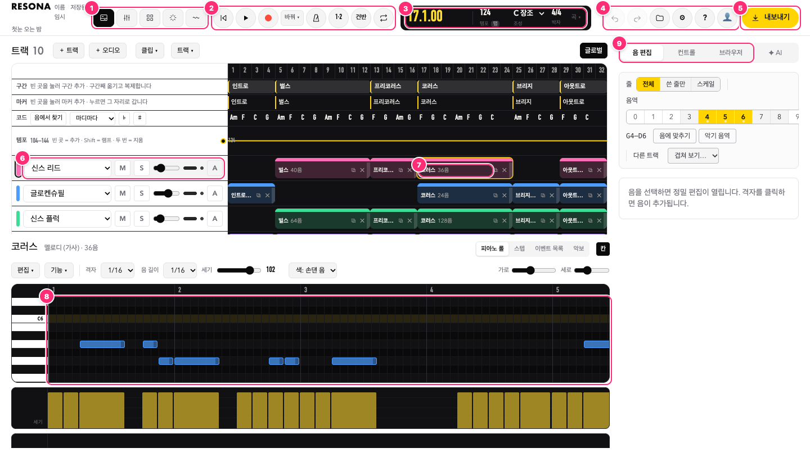

1. **보기 바꾸기** — 편집기 · 믹서 · 라이브 루프 · 도우미 · 튜닝 도구
2. **재생 줄** — 맨 앞으로, 재생, 녹음, 녹음 방식, 메트로놈, 카운트인, 건반, 반복
3. **검은 창** — 지금 위치 · 템포 · 조성 · 박자. 숫자를 눌러 바꿉니다
4. **되돌리기 · 파일 · 설정 · 도움말 · 계정**
5. **내보내기** — 완성한 곡을 파일로 받습니다
6. **트랙 한 줄** — 악기 하나. 악기 고르기, M(뮤트), S(솔로), 음량, A(오토메이션)
7. **클립** — 음이 든 색 막대. 누르면 아래에 그 안의 음이 열립니다
8. **편집기** — 고른 클립의 음. 여기서 음을 찍고 고칩니다
9. **오른쪽 칸** — 음 편집 · 컨트롤(손잡이) · 브라우저(악기 찾기)

### 2. 예제 곡 열기

오른쪽 위 폴더 단추 → **새 곡 · 최근 곡 · 버전**을 누르면 이 창이 뜹니다. ⌘O 로도 열립니다.

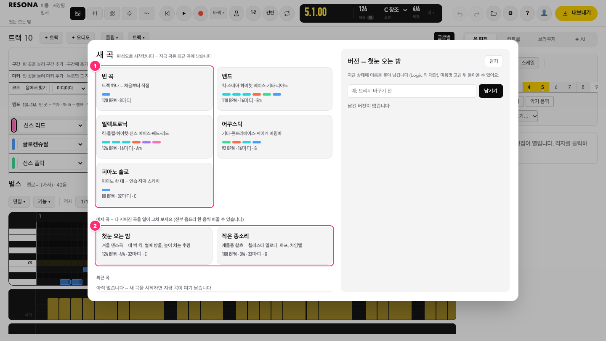

1. **새 곡 템플릿** — 빈 곡 · 밴드 · 일렉트로닉 · 어쿠스틱 · 피아노 솔로. 누르면 그 편성으로 시작합니다
2. **예제 곡** — 다 지어진 곡 두 개. 전부 음표라서 무엇이든 바꿀 수 있습니다

**해 보기**

- "첫눈 오는 밤"을 누릅니다.
- 창이 닫히고 곡이 열리면 **스페이스**를 눌러 듣습니다.

### 3. 듣기

재생은 언제나 커서가 있는 자리부터 시작합니다.

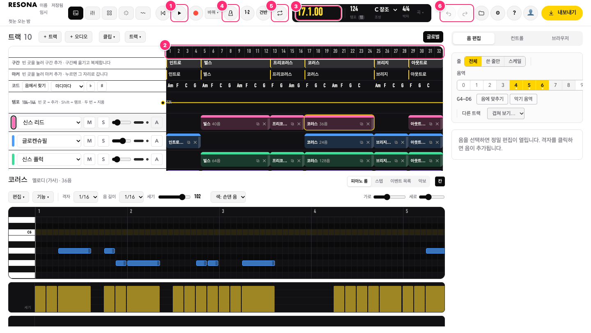

1. **재생 / 정지** — 스페이스와 같습니다
2. **눈금자** — 마디 번호. 누르면 그 마디로 가고, 누른 채 끌면 지나가는 음이 들립니다
3. **지금 위치** — 마디.박. 누르면 분:초로 바뀝니다
4. **메트로놈** — 박을 똑딱 소리로 들려줍니다. 내보낸 파일에는 안 들어갑니다
5. **반복** — 고른 구간만 되풀이해 듣습니다 (음을 고르고 ⌘L)
6. **되돌리기 / 다시 실행** — ⌘Z / ⇧⌘Z. 무엇을 눌러도 되돌릴 수 있으니 마음껏 눌러 보세요

**해 보기**

- 눈금자의 17을 누르고 스페이스 — 코러스부터 들립니다.

## 곡 짜기

### 4. 트랙과 클립

트랙은 악기 하나, 클립은 그 악기가 연주하는 한 토막입니다.

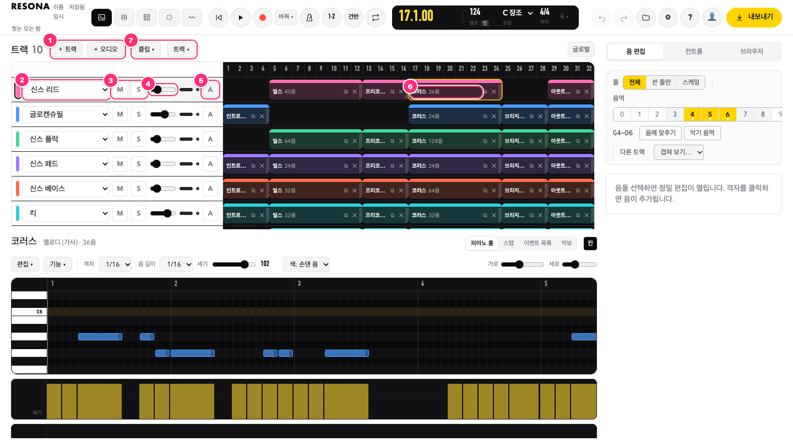

1. **＋ 트랙 / ＋ 오디오** — 악기 트랙, 또는 마이크 녹음·오디오 파일용 트랙을 더합니다
2. **악기 고르기** — 눌러서 이 트랙의 악기를 바꿉니다
3. **M / S** — M은 이 트랙 끄기, S는 이 트랙만 듣기
4. **음량** — 막대를 끌어 조절합니다. 옆의 작은 막대는 지금 소리 크기입니다
5. **A** — 시간에 따라 음량 등이 변하게 하는 곡선(오토메이션)을 펼칩니다
6. **클립** — 끌어서 옮기고, 끝을 끌어 길이를 바꿉니다. 빈 자리를 누르면 새 클립이 생깁니다
7. **클립 ▾ / 트랙 ▾** — 고른 클립·트랙에 하는 일. 우클릭해도 같은 목록이 열립니다

**해 보기**

- 글로켄슈필 트랙의 **S**를 누르고 재생 — 그 악기만 들립니다. 다시 눌러 풉니다.
- 코러스 클립을 옆으로 끌어 봅니다. ⌘Z 로 되돌립니다.

### 5. 클립에 하는 일

클립을 고르고 **클립 ▾**을 누르거나, 클립을 우클릭합니다.

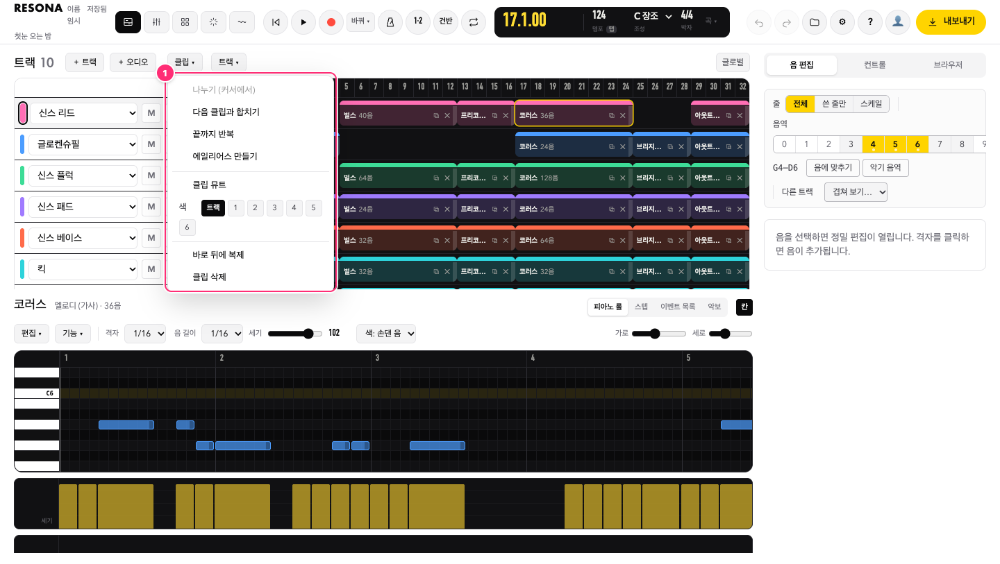

**나누기** — 커서 자리에서 둘로 · **합치기** — 다음 클립과 하나로 · **끝까지 반복** — 곡 끝까지 되풀이 · **에일리어스** — 원본을 따라 바뀌는 복사본 · **클립 뮤트** — 지우지 않고 소리만 빼기 · **색** · **바로 뒤에 복제** · **클립 삭제**

### 6. 트랙에 하는 일

트랙을 고르고 **트랙 ▾**을 누르거나, 트랙 이름 칸을 우클릭합니다.

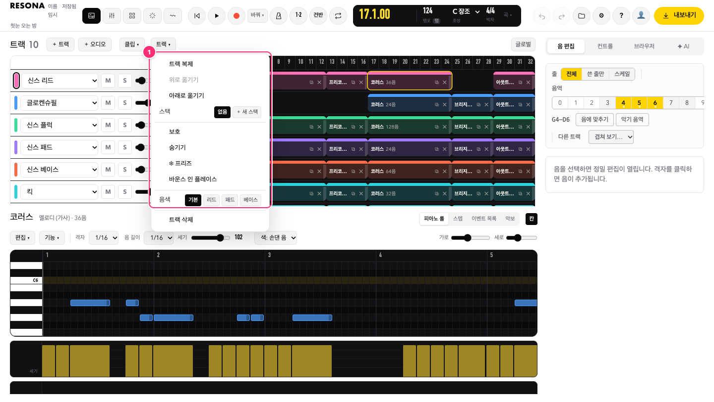

**트랙 복제** — 악기·이펙트·클립째 · **위로/아래로** · **스택** — 여러 트랙을 폴더로 묶기 · **보호** — 실수로 못 고치게 잠금 · **숨기기** · **프리즈** — 소리를 굳혀 컴퓨터 부담 줄이기 · **바운스 인 플레이스** — 오디오로 굳혀 아래 트랙에 · **음색** · **트랙 삭제**

### 7. 구간 · 코드 · 템포

타임라인 맨 위의 줄들입니다. 곡의 뼈대를 여기서 짭니다.

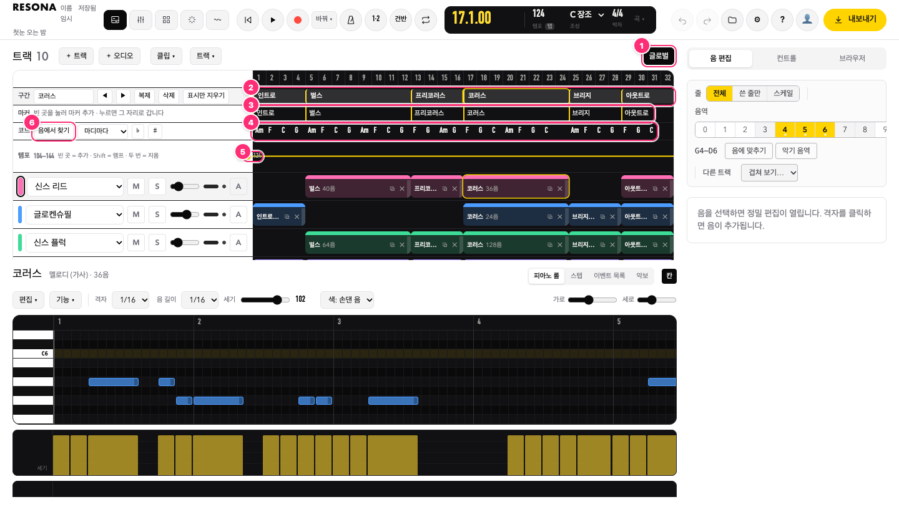

1. **글로벌** — 이 줄들을 보이거나 숨깁니다 (G)
2. **구간** — 인트로·벌스·코러스. 하나를 고르면 왼쪽에 ◀ ▶(자리 바꾸기) · 복제 · 삭제가 나옵니다. 안의 음악이 통째로 따라갑니다
3. **마커** — 자리 표시. 누르면 그 자리로 갑니다
4. **코드** — 마디마다의 코드. 눌러서 바꿉니다
5. **템포** — 점을 위아래로 끌면 빠르기가 바뀝니다. 빈 곳을 누르면 중간에 빠르기가 바뀌는 지점이 생깁니다
6. **음에서 찾기** — 찍어 둔 음을 읽어 코드를 알아서 채웁니다

**해 보기**

- 구간 줄의 "코러스"를 누르고 왼쪽의 **복제**를 누릅니다 — 코러스가 한 번 더 나옵니다.

## 음 고치기

### 8. 피아노 롤

세로가 음높이, 가로가 시간입니다. 가장 많이 쓰는 화면입니다.

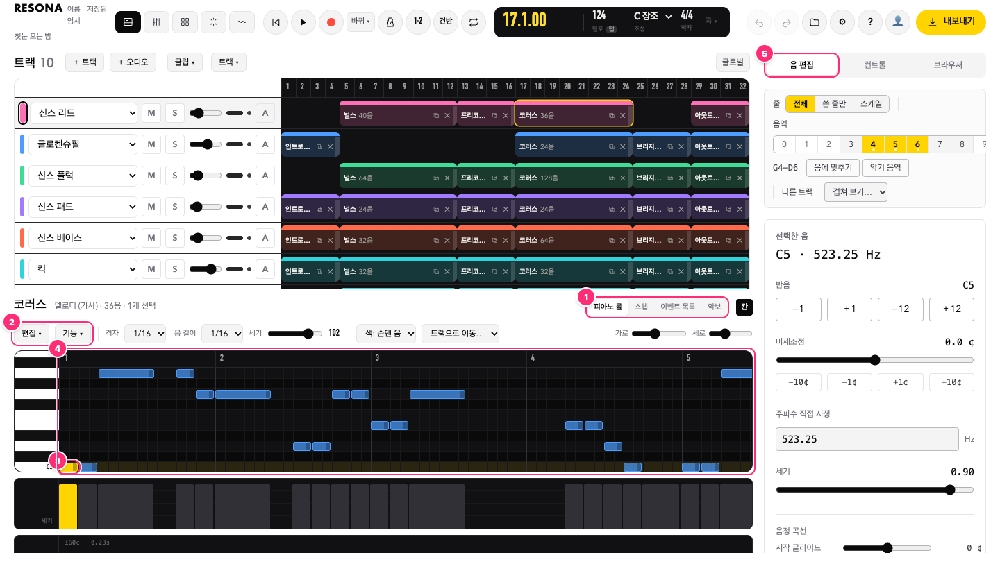

1. **보기 고르기** — 피아노 롤 · 스텝 · 이벤트 목록 · 악보. 같은 음을 네 가지로 봅니다
2. **편집 ▾ / 기능 ▾** — 복사·붙여넣기, 그리고 고른 음에 하는 일
3. **고른 음** — 노랗게 표시됩니다. 끌면 옮겨지고 오른쪽 끝을 끌면 길이가 바뀝니다
4. **격자** — 빈 곳을 누르면 음이 생깁니다. 빈 곳에서 끌면 여러 음을 한꺼번에 고릅니다
5. **음 편집** — 고른 음의 값. 반음 단추, 미세조정(센트 = 반음의 1/100), 주파수(Hz), 세기

**해 보기**

- 격자의 빈 곳을 눌러 음을 하나 넣습니다.
- 그 음을 위아래로 끌거나 ↑ ↓ 를 눌러 봅니다.
- Delete 로 지웁니다.

### 9. 고른 음에 하는 일

음을 고른 뒤 **기능 ▾**을 누릅니다. (그림은 음을 고르지 않아 흐리게 보입니다.)

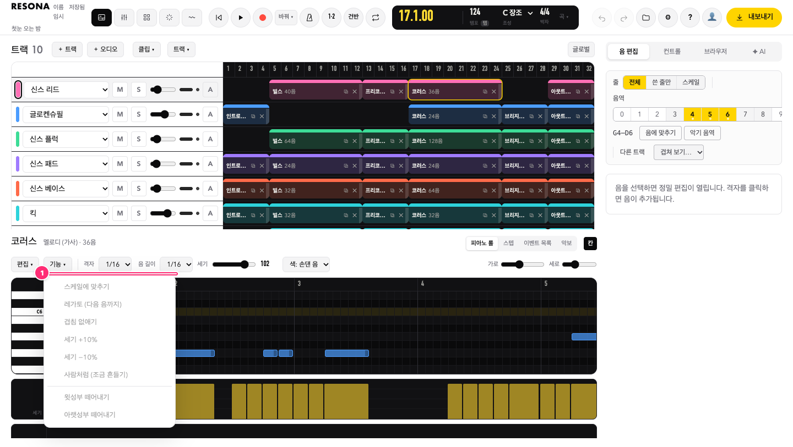

**스케일에 맞추기** — 조에 없는 음을 가까운 음으로 · **레가토** — 다음 음까지 늘이기 · **겹침 없애기** · **세기 ±10%** · **사람처럼** — 박자·세기를 조금 흔들기 · **윗성부 / 아랫성부 떼어내기** — 화음에서 맨 위·맨 아래 음만 골라내기

### 10. 스텝 — 드럼 찍기

칸 하나가 음 하나입니다. 드럼 트랙의 클립을 고르고 **스텝**을 누릅니다.

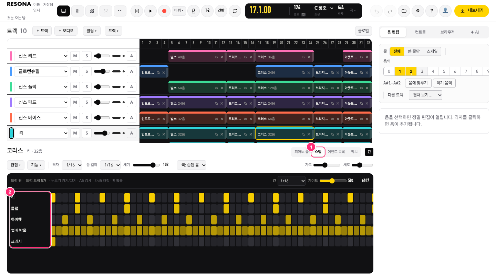

1. **스텝** 보기
2. **줄 = 드럼 종류** — 킥·클랩·하이햇이 한 판에 보입니다. 칸을 누르면 켜지고 꺼집니다

**해 보기**

- 비어 있는 칸을 눌러 킥을 하나 더합니다.
- Alt+누르기는 강세, Shift+누르기는 한 칸을 여러 번으로 쪼개 치기입니다.

### 11. 이벤트 목록 — 숫자로 고치기

모든 음을 표로 봅니다. 정확한 값이 필요할 때 씁니다.

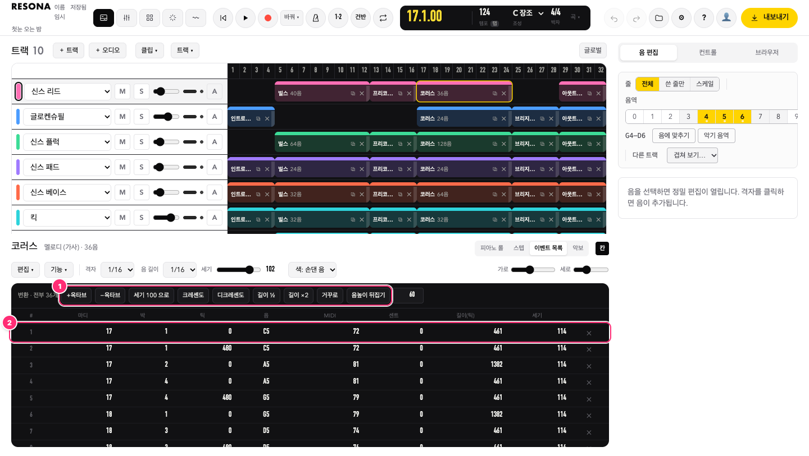

1. **변환 줄** — 고른 음(없으면 전부)에 한 번에: 옥타브 올리기·내리기, 세기 맞추기, 크레셴도, 길이 반·두 배, 거꾸로, 음높이 뒤집기
2. **음 한 줄** — 마디 · 박 · 틱 · 음 · MIDI 번호 · 센트 · 길이 · 세기. 칸을 눌러 숫자를 고칩니다

### 12. 악보와 가사

오선지로 봅니다. 가사는 여기서 붙입니다.

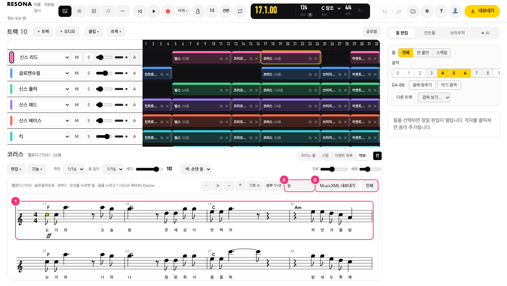

1. **악보** — 음을 누르면 고르고(노랑), 음 아래에 가사가 보입니다. 마디 위는 코드입니다
2. **가사 칸** — 음을 고르고 여기에 글자를 넣은 뒤 Enter
3. **MusicXML 내보내기 / 인쇄** — 다른 악보 프로그램으로 보내거나 종이로

**해 보기**

- 음을 하나 누르고 가사 칸에 글자를 넣고 Enter.

## 소리 만들기

### 13. 손잡이 (컨트롤)

고른 트랙의 소리를 손잡이 8개로 만집니다.

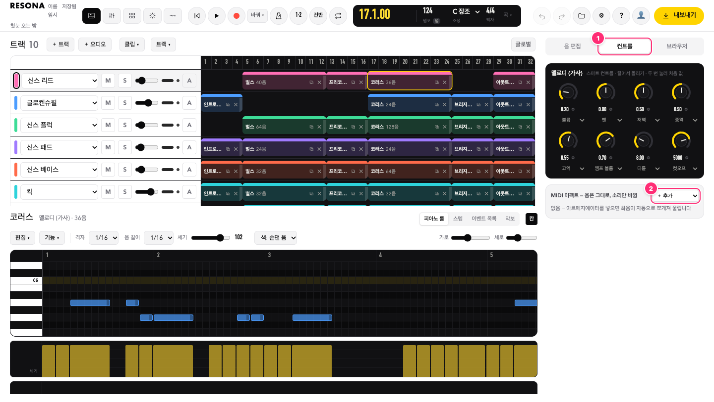

1. **컨트롤** 탭 — 손잡이를 위아래로 끌어 돌립니다. 두 번 누르면 처음 값. 손잡이 아래 이름을 누르면 무엇을 조절할지 바꿉니다
2. **MIDI 이펙트 추가** — 아르페지에이터(화음을 한 음씩 쪼개 연주) 등. 음은 그대로 두고 연주 방식만 바꿉니다

### 14. 악기 고르기 (브라우저)

악기 55종을 들어 보며 고릅니다.

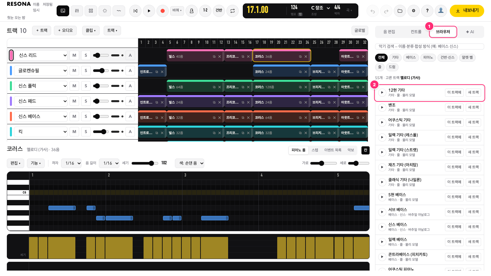

1. **브라우저** 탭 — 위에서 이름으로 찾거나 종류(기타·베이스·피아노…)로 거릅니다
2. **악기 한 줄** — ▶ 로 미리 듣고, **이 트랙에**(지금 트랙의 악기 바꾸기) 또는 **새 트랙**

### 15. 건반으로 치고 녹음하기

위쪽 **건반** 단추를 누르면 아래에 건반이 열립니다. 컴퓨터 자판으로도 칩니다.

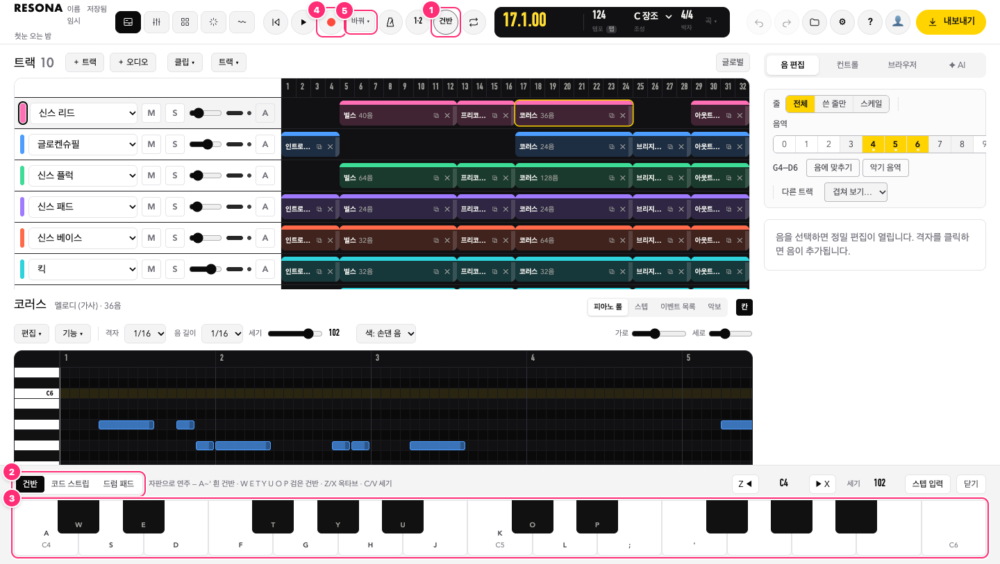

1. **건반** 단추
2. **연주 방식** — 건반 · 코드 스트립(단추 하나가 화음 하나) · 드럼 패드
3. **화면 건반** — 마우스로 누르거나, 건반에 적힌 자판 글쇠를 누릅니다
4. **녹음** — 누르고 치면 고른 클립에 음이 들어갑니다
5. **녹음 방식** — 바꿔 녹음(옛 음은 보관) · 겹쳐 녹음 · 펀치 · 방금 연주 담기

**해 보기**

- 건반을 열고 자판의 A S D F 를 눌러 봅니다.

## 믹스와 마무리

### 16. 믹서

트랙들의 음량과 이펙트를 한 화면에서 맞춥니다.

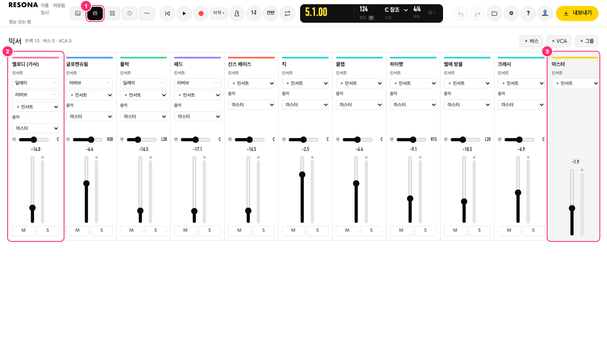

1. **믹서** 보기
2. **채널 하나** — 위에서부터 인서트(이펙트) · 출력 · 팬(좌우) · 페이더(음량) · M/S. "+ 인서트"로 리버브·EQ·컴프레서 등 80여 종을 겁니다
3. **마스터** — 모든 소리가 모이는 마지막 채널

**해 보기**

- 아무 채널의 페이더를 끌어 음량을 바꿔 봅니다. 두 번 누르면 원래 값으로 돌아갑니다.

### 17. 오토메이션

후렴에서 음량이 커지거나, 소리가 서서히 열리게 합니다.

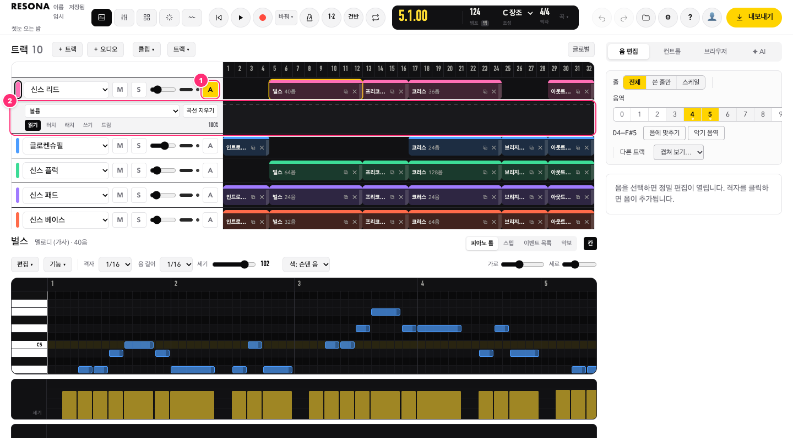

1. **A** 단추 — 그 트랙 아래에 곡선 줄이 펼쳐집니다
2. **곡선 줄** — 왼쪽에서 무엇을 움직일지(볼륨·팬·이펙트) 고르고, 오른쪽 빈 곳을 눌러 점을 찍습니다. 점을 끌면 이동, 두 번 누르면 삭제

### 18. 도우미 — 반주 자동으로

코드 줄을 읽고 드럼·베이스·건반 반주를 만들어 줍니다. 인터넷 없이 됩니다.

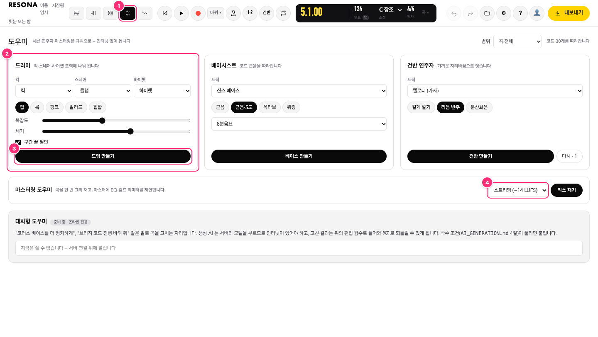

1. **도우미** 보기
2. **드러머** — 어느 트랙에 칠지, 스타일(팝·록·펑크·발라드·힙합), 복잡도, 세기
3. **드럼 만들기** — 누르면 음이 채워집니다. 베이시스트·건반 연주자도 같습니다
4. **마스터링 도우미** — 목표를 고르고 "믹스 재기"를 누르면 음량을 재고 마스터 설정을 제안합니다

### 19. 내보내기

오른쪽 위 노란 **내보내기**를 누릅니다.

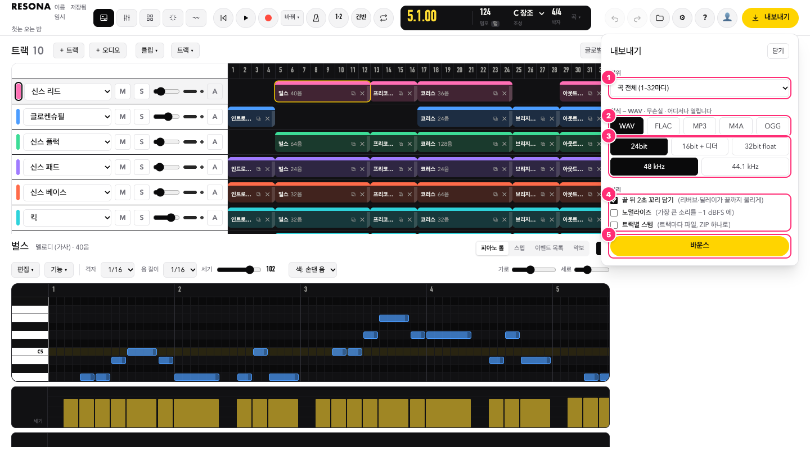

1. **범위** — 곡 전체 · 반복 구간 · 구간 하나(코러스만 등)
2. **형식** — WAV(무손실) · FLAC(무손실, 작게) · MP3 · M4A · OGG
3. **품질** — 무손실은 비트 깊이, MP3 등은 비트레이트. 그리고 표본율
4. **처리** — 끝 뒤 2초 꼬리 · 노멀라이즈(음량 채우기) · 트랙별 스템(트랙마다 파일)
5. **바운스** — 누르면 파일이 내려오고, 아래에 그 파일의 음량(LUFS)과 피크가 표시됩니다

**해 보기**

- MP3 를 고르고 바운스 — 남에게 보내기 좋은 파일이 나옵니다.

## 그 밖에

### 20. 저장 · 가져오기

폴더 단추를 누르면 열립니다. 고칠 때마다 자동 저장되지만, **중요한 곡은 파일로 받아 두세요.**

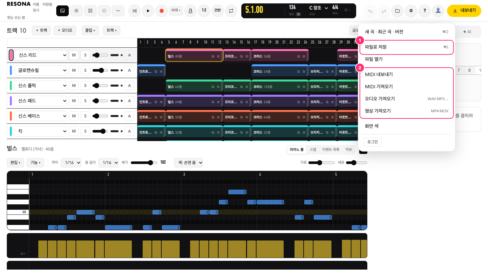

1. **파일로 저장** (⌘S) — 곡 파일을 내 컴퓨터에 받습니다. **파일 열기**로 다시 엽니다
2. **MIDI 내보내기·가져오기 · 오디오 가져오기 · 영상 가져오기**

### 21. 명령 찾기

어디 있는지 모르겠으면 **⌘K**를 누르고 이름을 칩니다.

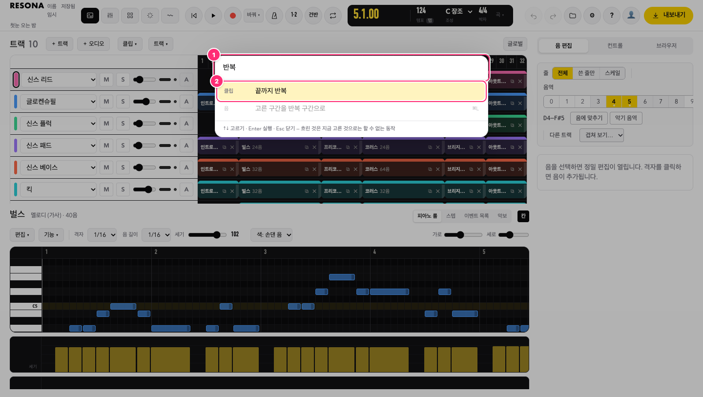

1. **찾기 칸** — 기능 이름의 일부만 쳐도 됩니다
2. **결과** — ↑↓ 로 고르고 Enter 로 실행. 흐린 것은 지금 고른 것으로는 할 수 없는 동작입니다

### 22. 설정과 단축키

톱니 단추 또는 ⌘, 로 엽니다.

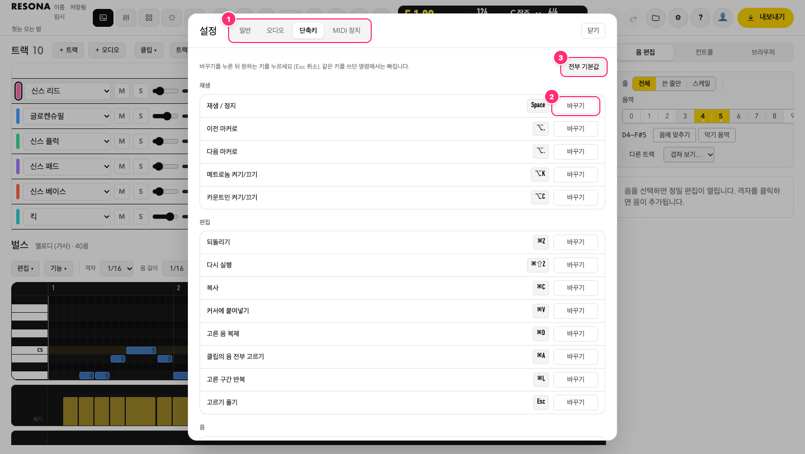

1. **탭** — 일반(조율·카운트인) · 오디오(스피커·마이크) · 단축키 · MIDI 장치
2. **바꾸기** — 누른 뒤 원하는 키를 누르면 그 명령의 단축키가 바뀝니다
3. **전부 기본값**

## 자주 막히는 곳

- **소리가 안 나요** — 재생 단추를 직접 한 번 눌러 보세요. 트랙이 뮤트(M)됐거나 다른 트랙이 솔로(S)인지도 확인하세요.
- **음이 안 찍혀요** — 타임라인에서 클립을 먼저 골라야 아래 편집기가 열립니다. 트랙이 보호(자물쇠)돼 있으면 풀어야 합니다.
- **내보낸 파일이 찌그러져요** — 내보내기 창의 트루 피크가 0에 가깝거나 넘으면 마스터 음량을 내리거나 노멀라이즈를 켜세요.
- **곡이 사라졌어요** — 곡 고르기 창의 최근 곡을 보세요. 없다면 파일로 받아 둔 것을 파일 열기로 엽니다.
- **MP3·M4A를 처음 고르면 잠깐 멈춰요** — 그 형식의 인코더를 그때 내려받습니다. 두 번째부터는 바로 됩니다.
