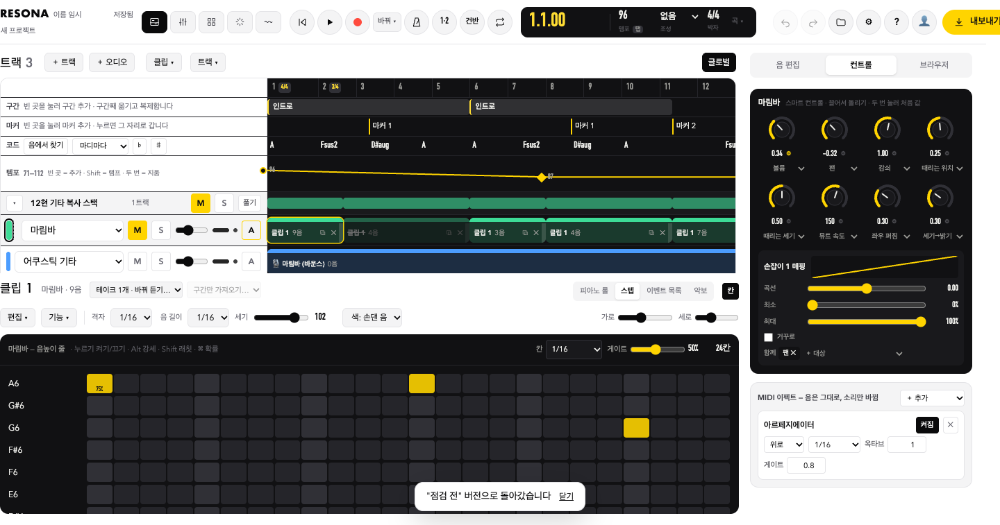
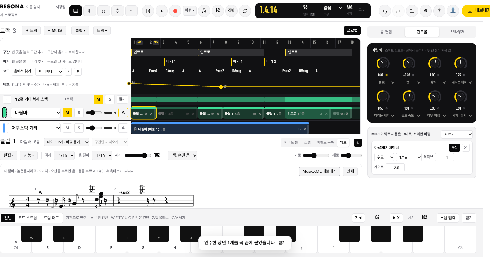
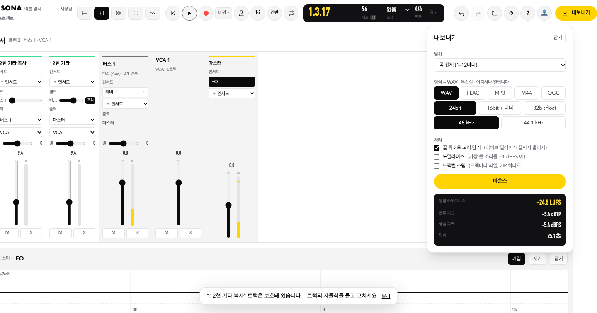
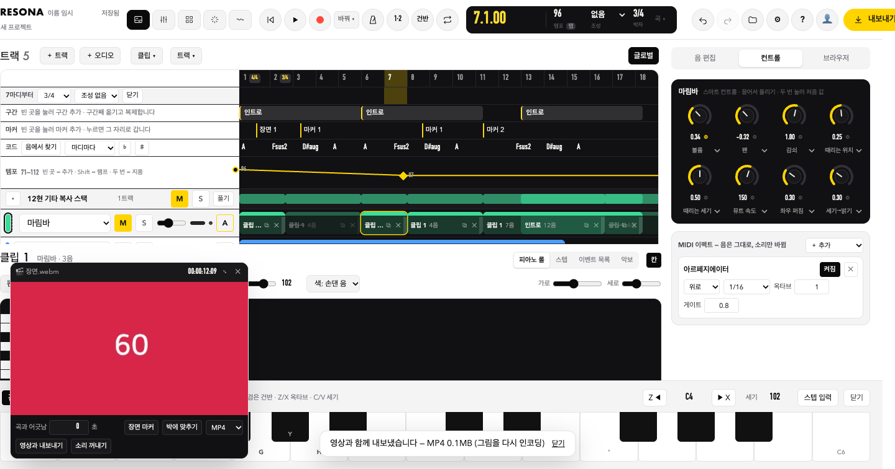

# 사용 가이드

처음 여는 사람이 곡 하나를 만들어 파일로 받기까지 순서대로 적었습니다. 단축키의 ⌘는 Windows에서 Ctrl입니다.

- [화면 구성](#화면-구성)
- [5분 만에 해 보기](#5분-만에-해-보기)
- [곡 만드는 순서](#곡-만드는-순서)
- [음 고치기](#음-고치기)
- [클립과 트랙](#클립과-트랙)
- [녹음과 오디오](#녹음과-오디오)
- [믹서와 이펙트](#믹서와-이펙트)
- [내보내기](#내보내기)
- [영상에 음악 붙이기](#영상에-음악-붙이기)
- [저장과 불러오기](#저장과-불러오기)
- [단축키](#단축키)
- [자주 막히는 곳](#자주-막히는-곳)

## 화면 구성

| 자리 | 하는 일 |
|---|---|
| **맨 위 줄** | 보기 전환(편집기·믹서·라이브 루프·도우미·튜닝), 재생·녹음, 메트로놈, 반복, 가운데 검은 창(위치·템포·조·박자), 오른쪽에 되돌리기·파일·설정·도움말·계정·**내보내기** |
| **위쪽 — 타임라인** | 트랙이 세로로, 시간이 가로로. 색 막대 하나가 **클립**(음 묶음)입니다 |
| **글로벌 트랙** | 타임라인 맨 위의 구간·마커·코드·템포 줄. `G`로 켜고 끕니다 |
| **아래쪽 — 편집기** | 고른 클립의 음. 피아노 롤 · 스텝 · 이벤트 목록 · 악보 네 가지로 봅니다 |
| **오른쪽 칸** | 고른 음의 값, 악기 손잡이(컨트롤), 악기 고르기(브라우저). `I`로 켜고 끕니다 |

모르는 기능은 **⌘K**로 이름을 쳐서 찾을 수 있습니다. 물음표 단추에는 짧은 도움말이 있습니다.

## 5분 만에 해 보기

1. **폴더 단추 → 새 곡 · 최근 곡 · 버전**을 엽니다.
2. **예제 곡**에서 "첫눈 오는 밤"(겨울 댄스곡) 또는 "작은 종소리"(캐롤 왈츠)를 고릅니다.
3. **스페이스**로 재생합니다. 다시 누르면 멈춥니다.
4. 타임라인에서 "코러스" 클립을 누르면 아래 편집기에 그 음이 뜹니다. 음 하나를 위아래로 끌어 보세요.
5. **⌘Z**로 되돌립니다.
6. **내보내기 → MP3 → 바운스**를 누르면 파일이 내려옵니다.

## 곡 만드는 순서

빈 곡에서 시작한다면 이 순서가 편합니다. 예제 곡 두 개도 이 순서로 지었습니다.

1. **새 곡을 만든다.** 곡 고르기 창에서 템플릿(밴드·일렉트로닉·어쿠스틱·피아노 솔로·빈 곡)을 고릅니다.
2. **템포·조·박자를 정한다.** 맨 위 검은 창의 숫자를 누릅니다. 댄스곡은 120~128에 4/4, 왈츠는 3/4입니다.
3. **구간을 나눈다.** 글로벌 트랙(`G`)의 구간 줄 빈 곳을 눌러 인트로·벌스·코러스를 만듭니다.
4. **코드를 깐다.** 코드 줄에 마디마다 코드를 넣습니다. 이미 음이 있으면 "음에서 찾기"가 코드를 읽어 줍니다.
5. **멜로디를 찍는다.** 트랙의 빈 레인을 눌러 클립을 만들고, 아래 피아노 롤의 빈 곳을 눌러 음을 넣습니다.
6. **반주를 채운다.** `+ 트랙`으로 베이스·패드·드럼을 더합니다. 드럼은 스텝 보기가 빠릅니다.
7. **구간마다 악기를 넣었다 뺀다.** 벌스는 비우고 코러스는 채우는 식으로 클립을 두거나 지웁니다.
8. **믹서에서 음량을 맞춘다.** 그리고 내보냅니다.

막히면 **도우미** 보기가 코드 진행·드럼 패턴을 제안하고, 마스터링 도우미가 음량을 재서 고칠 곳을 알려 줍니다.

## 음 고치기

아래 편집기 오른쪽 위에서 보기를 바꿉니다.

| 보기 | 언제 |
|---|---|
| **피아노 롤** | 멜로디·화음. 세로가 음높이, 가로가 시간 |
| **스텝** | 드럼·반복 패턴. 칸을 눌러 켜고 끕니다 |
| **이벤트 목록** | 숫자로 정확히 고칠 때(시작·길이·세기·MIDI 번호) |
| **악보** | 오선지로 보고 가사를 붙일 때. MusicXML로 내보낼 수 있습니다 |

피아노 롤에서:

- **빈 곳 클릭** — 음 추가. **끌기** — 여러 음 고르기. **Shift+클릭** — 고른 것에 더하기.
- **음을 끌면** 옮겨지고, **오른쪽 끝을 끌면** 길이가 바뀝니다.
- **↑ ↓** 반음씩, **Delete** 삭제, **Esc** 선택 해제.
- **⌘C / ⌘V** 복사·붙여넣기, **⌘D** 복제, **⌘A** 전체 선택.
- 위의 **격자**(1/16 등)가 음이 달라붙는 간격이고, **기능 ▾**에 퀀타이즈·레가토·스케일 맞추기·사람처럼(타이밍 흩기)이 있습니다.
- 오른쪽 칸 **음 편집**에서 세기와 **센트 단위 음정**을 고칩니다.

가사는 악보 보기에서 음을 고르고 입력합니다. 가사는 음에 붙는 글자이고 노래로 불러 주지는 않습니다.

## 클립과 트랙

**클립** — 타임라인의 색 막대.

- 빈 레인 클릭으로 만들고, 끌어서 옮기고, 끝을 끌어 길이를 바꿉니다.
- **우클릭** 또는 **클립 ▾** — 나누기(커서에서), 합치기, 반복, 복제, 색, 뮤트.
- 구간(벌스·코러스)을 옮기거나 복제하면 그 안의 클립이 통째로 따라갑니다.

**트랙** — 악기 하나.

- `+ 트랙`으로 더하고, 이름 옆 목록에서 악기를 바꿉니다. 오른쪽 칸 **브라우저**에서 들어 보며 고를 수도 있습니다.
- **M** 뮤트, **S** 솔로, 그 옆 막대가 음량입니다.
- **이름 칸 우클릭** 또는 **트랙 ▾** — 복제, 보호(잠금), 숨기기, 프리즈, 바운스 인 플레이스(오디오로 굳히기), 폴더로 묶기.

## 녹음과 오디오

- **마이크 녹음**: `+ 오디오`로 오디오 트랙을 만들고 빨간 녹음 단추를 누릅니다. 브라우저가 마이크 권한을 묻습니다.
- **파일 가져오기**: 폴더 단추 → **오디오 가져오기**. WAV·MP3·AAC·FLAC·OGG를 받습니다.
- **MIDI 건반**: 연결하면 바로 칩니다. 장치는 설정(⌘,)에서 고릅니다. 컴퓨터 자판으로도 칠 수 있습니다.
- 오디오 클립은 시작·끝 다듬기, 게인, 페이드, 거꾸로, 나누기가 됩니다.

실제 보컬을 넣으려면 오디오 트랙에 녹음하세요. 예제 곡의 멜로디 트랙을 뮤트하고 그 자리에 부르면 됩니다.

## 믹서와 이펙트

위쪽 두 번째 단추가 믹서입니다.

- 채널마다 **인서트**(이펙트)를 겁니다 — EQ, 컴프레서, 리버브, 딜레이, 코러스, 리미터 등.
- **센드**로 여러 트랙을 한 버스(예: 리버브 하나)에 보냅니다.
- **VCA**는 여러 트랙의 음량을 한 손잡이로 움직입니다.
- 타임라인 트랙의 **A** 단추가 오토메이션(시간에 따라 음량·팬 등이 변하게)입니다.
- 마스터 채널에 리미터를 걸고 천장을 −1dB에 두면 스트리밍에 올리기 안전합니다.

## 내보내기

오른쪽 위 노란 **내보내기** 단추입니다.

| 고를 것 | 선택지 |
|---|---|
| **범위** | 곡 전체 · 반복 구간 · 구간 하나(코러스만 등) |
| **형식** | WAV · FLAC · MP3 · M4A · OGG |
| **품질** | 무손실은 비트 깊이(24bit, 16bit + 디더, WAV는 32bit float), 손실은 비트레이트(128~320k) |
| **표본율** | 48kHz · 44.1kHz (OGG는 48kHz만) |
| **처리** | 끝 뒤 2초 꼬리, 노멀라이즈(−1dBFS), 트랙별 스템(ZIP) |

어떤 형식을 고를지:

- **남에게 들려줄 때** — MP3 256k 또는 M4A.
- **유통사·마스터링에 넘길 때** — WAV 24bit 48kHz.
- **다른 DAW에서 더 만질 때** — 스템을 켜고 WAV 32bit float.
- **보관** — FLAC(WAV와 같은 소리, 크기는 절반쯤).

내보내면 창 아래에 그 파일의 **라우드니스(LUFS)와 트루 피크**가 나옵니다. 트루 피크가 −1dBTP를 넘으면 경고가 뜹니다.

그 밖의 내보내기:

- **MIDI** — 폴더 단추 → MIDI 내보내기. 음·템포·박자·트랙 이름·가사가 나갑니다. 센트 단위 음정은 반올림되고, 그럴 때 알려 줍니다.
- **악보** — 악보 보기의 MusicXML 내보내기. MuseScore·Sibelius 등에서 엽니다.

## 영상에 음악 붙이기

1. 폴더 단추 → **영상 가져오기**. 왼쪽 아래에 영상 창이 뜨고 재생을 따라갑니다.
2. **곡과 어긋남**(초)으로 영상이 곡의 어디서 시작하는지 맞춥니다.
3. 장면이 바뀌는 곳에서 **장면 마커**를 놓습니다.
4. **박에 맞추기**는 지금 자리가 박에 떨어지도록 템포를 조금(8% 안에서) 바꿉니다. 템포 변화가 있는 곡에서는 하지 않습니다.
5. **MP4/WebM을 고르고 영상과 내보내기** — 영상의 그림에 곡의 믹스를 붙인 파일이 나옵니다. 영상의 원래 소리는 빠지니, 필요하면 **소리 꺼내기**로 먼저 오디오 트랙에 올리세요.

검은 창의 표시를 타임코드로 바꿀 수 있고, 프레임 수(23.976~60fps)는 곡 설정에서 정합니다.

## 저장과 불러오기

- **자동 저장** — 고칠 때마다 이 브라우저에 저장됩니다. 새로고침해도 곡이 그대로입니다.
- **최근 곡 · 버전** — 곡 고르기 창에 최근 곡이 남고, "브리지 바꾸기 전" 같은 이름으로 버전을 남겼다가 돌아갈 수 있습니다.
- **파일로 저장(⌘S)** — 곡 파일(.json, 오디오가 있으면 .zip)을 내려받습니다. **중요한 곡은 꼭 파일로 받아 두세요.** 브라우저 저장소는 5MB쯤이라 곡이 많아지면 오래된 최근 곡부터 지워지고, 브라우저 데이터를 지우면 함께 사라집니다.
- **클라우드** — 로그인하면 서버에 저장하고 다른 기기에서 엽니다. 로그인하지 않아도 위의 것은 모두 됩니다.

## 단축키

설정(⌘,)에서 바꿀 수 있습니다.

| 키 | 동작 |
|---|---|
| Space | 커서부터 재생 / 정지 |
| ⌘Z / ⇧⌘Z | 되돌리기 / 다시 실행 |
| ⌘C · ⌘V · ⌘D · ⌘A | 복사 · 붙여넣기 · 복제 · 전체 선택 |
| ↑ ↓ | 고른 음을 반음씩 |
| Delete | 고른 음 지우기 |
| Esc | 선택 해제 |
| ⌘L | 고른 구간 반복 |
| ⌥, · ⌥. | 이전 · 다음 마커 |
| G | 글로벌 트랙 켜기/끄기 |
| I | 오른쪽 칸 켜기/끄기 |
| 1~9 · ⇧1~9 | 스크린셋 부르기 · 저장 |
| ⌘S · ⌘O | 파일로 저장 · 곡 고르기 |
| ⌘K | 명령 찾기 |
| ⌘, | 설정 |

## 자주 막히는 곳

- **소리가 안 나요** — 브라우저는 화면을 한 번 눌러야 소리를 냅니다. 재생 단추를 직접 눌러 보세요. 트랙이 뮤트(M)됐거나 다른 트랙이 솔로(S)인지도 확인하세요.
- **음이 안 찍혀요** — 타임라인에서 클립을 먼저 골라야 아래 편집기가 열립니다. 트랙이 보호(자물쇠)돼 있으면 풀어야 합니다.
- **내보낸 파일이 찌그러져요** — 내보내기 창의 트루 피크가 0에 가깝거나 넘으면 마스터 음량을 내리거나 노멀라이즈를 켜세요.
- **곡이 사라졌어요** — 곡 고르기 창의 최근 곡을 보세요. 없다면 파일로 받아 둔 것을 **파일 열기**로 엽니다.
- **MP3·M4A를 처음 고르면 잠깐 멈춰요** — 그 형식의 인코더를 그때 내려받습니다. 두 번째부터는 바로 됩니다.
- **권장 브라우저** — Chrome·Edge. 다른 브라우저에서는 일부 형식(영상 내보내기, OGG)이 안 될 수 있습니다.
